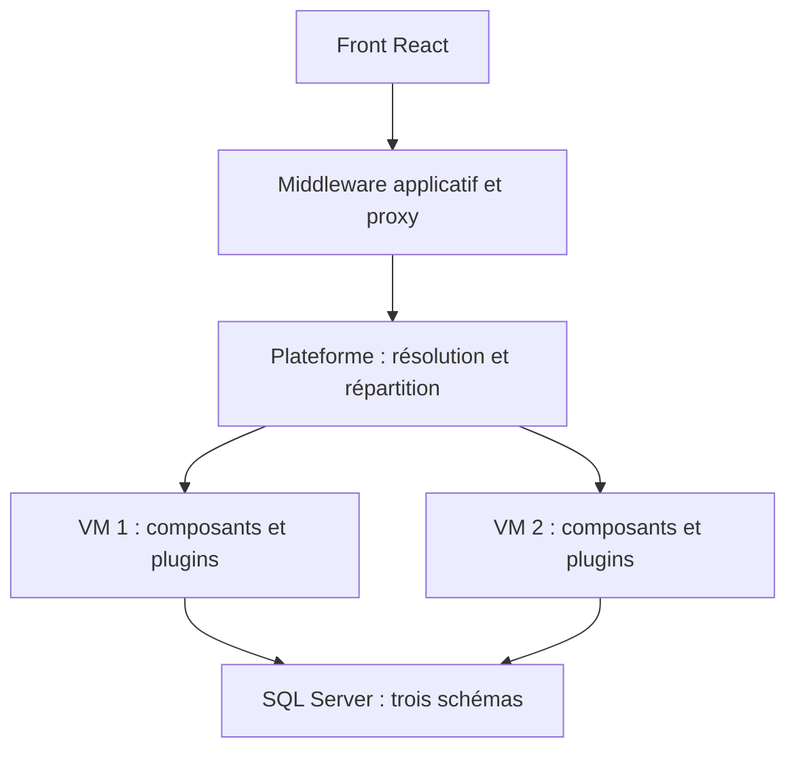

# Architecture logicielle

## Correspondance avec le sujet

L’application est une interface web intranet ; les employés utilisent le navigateur de leur poste Windows 10. Le front, le middleware propre à l’application et son proxy constituent la partie applicative. La plateforme et les composants constituent des services séparés.

Le terme « middleware local » est interprété comme une couche propre à l’application et distincte de la plateforme. Aucun appel SQL ne part du navigateur. Si l’enseignant exige une API exécutée sur chaque poste, le placement du middleware et l’authentification doivent être revus avant installation ; le dépôt ne prétend pas avoir validé cette variante.

## Traitement d’une demande

1. Le front utilise `ApplicationApi.call`, qui produit un contrat commun avec `requestId`, type/version de client, opération et données.
2. Le middleware applicatif vérifie la session et l’antiforgery, puis les droits de l’opération.
3. `SecureProxy` chiffre le contrat pédagogique et l’envoie au point d’entrée `/platform/dispatch`.
4. Le contrôleur de résolution vérifie l’enveloppe, le type/version du client, l’opération et les rôles. Le type/version est une vérification de compatibilité, pas une preuve d’identité.
5. La plateforme choisit une instance en rotation. Les lectures peuvent essayer l’autre instance en cas d’indisponibilité. Les écritures ne sont pas réessayées automatiquement pour éviter de doubler une mutation dont le résultat serait incertain.
6. `/components/execute` contrôle à nouveau l’opération et appelle le plugin responsable via `OperationEngine`.
7. `DataProxy` ouvre une transaction sérialisable, effectue les modifications et leur audit, puis valide la transaction. Les exceptions provoquent le rollback.
8. La réponse normalisée est chiffrée sur chaque retour entre services, puis présentée par le middleware au front.

Les trois plugins métier sont indépendants : Catalogue, Procédés, Tests. Le plugin Reporting fournit le tableau de bord, l’audit et le diagnostic d’identité. Les interfaces et contrats permettent de remplacer les implémentations sans lier les écrans aux transports.

## Données et schémas

| Schéma | Éléments | Justification |
| --- | --- | --- |
| `SCH_RD` | Modèles, ingrédients, compositions, définitions/valeurs de caractéristiques, procédés, étapes, définitions des tests | La R&D conçoit ces données. |
| `SCH_TEST` | Exécutions et audit | Résultats, décisions et preuve des modifications. |
| `SCH_PROD` | Vues des modèles, compositions, caractéristiques, procédés et étapes validés | Les utilisateurs de production ne reçoivent pas d’accès direct aux tables de R&D. |

Le propriétaire des schémas est commun pour permettre la chaîne de propriété des vues SQL. Aucune table applicative n’utilise le schéma `dbo`. Les profils serveur DBA/BCK/USR et les comptes des processus SQL/Agent relèvent de Ramzi.

Les quantités sont stockées en centigrammes entiers (`12537` = `125,37 g`). Le prix suit la même convention en centimes. Le front refuse les valeurs avec plus de deux décimales. Les caractéristiques numériques sont validées comme décimaux textuels, séparément des quantités.

Les identifiants sont des GUID. Une révision est contrôlée à chaque édition/suppression d’un élément versionné. La révision du modèle est aussi la version de validation de ses tests ; une modification métier incrémente cette révision et révoque sa publication.

## Démonstration et déploiement

La démo lance quatre processus sur loopback et deux instances partageant SQLite. Ce fonctionnement sert à vérifier les flux et la logique ; il ne simule pas une fédération AD et n’est pas présenté comme une preuve de deux VM physiques.

Le déploiement cible utilise un hôte applicatif, une plateforme, deux VM Windows de composants et un SQL Server commun. En mode domaine, chaque saut HTTP et l’accès SQL exécutent explicitement l’action sous l’identité Windows déléguée du collaborateur. Le proxy ne partage pas de connexion HTTP authentifiée entre utilisateurs. `DataProxy` vérifie `ORIGINAL_LOGIN()` et bloque le traitement si SQL utilise une autre identité.

## Supervision

`/health` donne uniquement l’état de vie du processus. Il ne prouve pas que SQL ou les autres services fonctionnent. `/metrics`, protégé par le rôle R&D, fournit les compteurs de demandes/erreurs et les durées cumulées des composants ; la plateforme expose ses succès/échecs et son nombre de destinations. Le diagnostic `system.identity` vérifie le chemin complet jusqu’à la base et identifie l’instance.

L’audit contient l’acteur, l’action, l’objet, la date et le suivi de la mutation ; il ne copie pas les recettes ni les contenus confidentiels dans les journaux.
