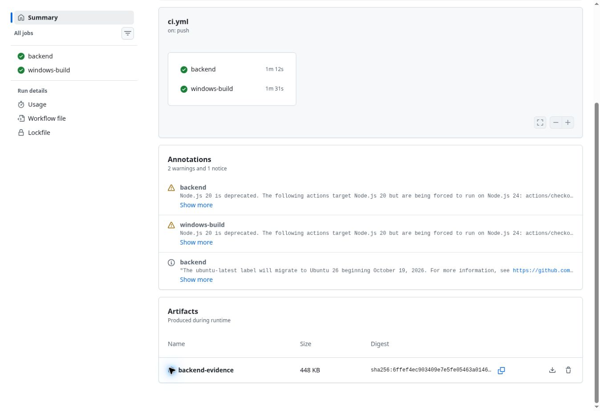

# Résultat de vérification

Le code applicatif du commit `cd4645e704d1f1ae6baec2cc244dd6f3d3791567` a été vérifié le 19 octobre 2026 par [KillerBee CI, exécution 5](https://github.com/iheb-mrabet/killerbee/actions/runs/39318782573).

| Vérification | Résultat |
| --- | --- |
| Construction backend Linux | Réussie |
| Construction backend Windows | Réussie |
| Tests backend | 15 réussis sur chaque OS |
| Construction TypeScript / Vite | Réussie |
| Tests de conversion des quantités/prix | 2 réussis |
| Vérifications E2E et Chromium | 26 réussies |
| Audit npm des dépendances de production | Aucune vulnérabilité signalée lors de cette exécution |
| Vue mobile 390 px | Aucun débordement horizontal détecté |

Les vérifications E2E traversent le middleware, la plateforme et les deux instances de composants. Elles couvrent les profils, l’antiforgery, les accès interdits, les quantités exactes, les champs dynamiques, les procédés, les suppressions protégées, les tests échoués, les approbations, la révocation après modification, l’audit et les formulaires du navigateur.

L’artefact `backend-evidence` du workflow contient le rapport TRX, le schéma SQL généré, les captures de l’application (tableau de bord, modèles, mobile) et les journaux de démonstration. La capture ci-dessous montre la réussite des deux jobs.

La démonstration et la CI utilisent SQLite et des comptes fictifs sur loopback. L’AD réel, Kerberos, SQL Server, les permissions exécutées dans SQL, les certificats et les deux VM physiques doivent encore être vérifiés dans votre maquette, selon [DEPLOYMENT.md](DEPLOYMENT.md). La capture est une preuve de cette exécution, pas une garantie sur une configuration externe.
